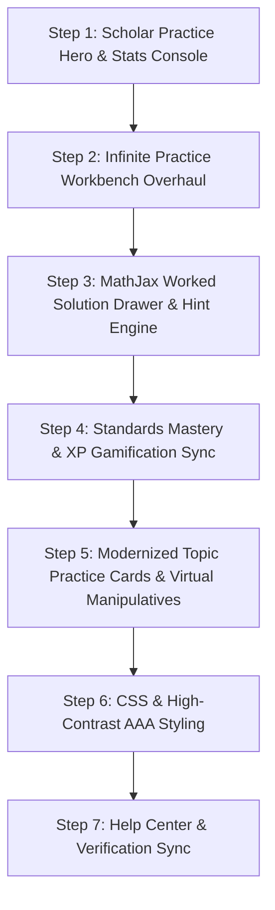

# Math Practice Workbench Modernization Plan

## 1. Overview
The **Math Practice Workbench** (`/student/math-practice.php`) provides an interactive computational laboratory equipped with an infinite problem generator, step-by-step MathJax worked proofs, manipulative tools, and discipline topic practice. 

This modernization upgrades the workbench to the platform's `v2.19.0` glassmorphic design standards, removes obsolete Tailwind utility leaks and inline styles, connects solved problems directly to `hesten_standards_mastery`, and enforces WCAG 2.1/2.2 AA & AAA compliance.

---

## 2. Seven-Step Phased Execution

### Detailed Breakdown

1. **Step 1: Scholar Practice Hero & Stats Console**
   - Modernize the header into a branded scholar practice console consistent with the Student Hub (`/student/index.php`).
   - Clean streak counters (`🔥 Streak`), solved problems, and computational accuracy percentage with high-contrast accessibility.

2. **Step 2: Infinite Practice Workbench Overhaul**
   - Overhaul the category selector tabs (Linear Equations, Quadratic Factoring, Fractions & Decimals, Pythagorean Theorem).
   - Modernize the active problem stage, LaTeX equation container, accessible math input field, and check answer trigger.

3. **Step 3: MathJax Worked Solution Drawer & Hint Engine**
   - Enhance the step-by-step worked solution drawer with auto-typeset MathJax rendering via `window.ensureMathJax`.
   - Add clear mathematical callout cards with deductive logic and keyboard-operable solution toggles.

4. **Step 4: Standards Mastery & XP Gamification Sync**
   - Automatically record problem completions and mastery streaks directly into canonical `hesten_standards_mastery` and dispatch `standards-mastery-updated` and `hl:data-sync` events.
   - Synchronize XP awards with `hl_gamification_profile` and daily quests.

5. **Step 5: Modernized Topic Practice Cards & Virtual Manipulatives**
   - Modernize the 6 discipline practice cards (Algebra, Geometry, Calculus, Statistics, Number Theory, Applied Math) with glassmorphic cards, domain tags, and accessible action buttons.
   - Streamline access to integrated virtual math manipulatives (rulers, protractors, unit circle).

6. **Step 6: CSS & High-Contrast AAA Styling**
   - Add dark theme and AAA high-contrast overrides (true black background, high-contrast focus rings, vibrant yellow symbols).
   - Eliminate legacy Tailwind classes (`mt-auto px-4 py-2 bg-primary text-white rounded-lg`) and unstyled inline wrappers.

7. **Step 7: Help Center & Verification Sync**
   - Create or update companion user guide in `assets/text/hc-math-practice-workbench.md`.
   - Update platform release notes and walkthrough documentation in `updates/docs/`.
