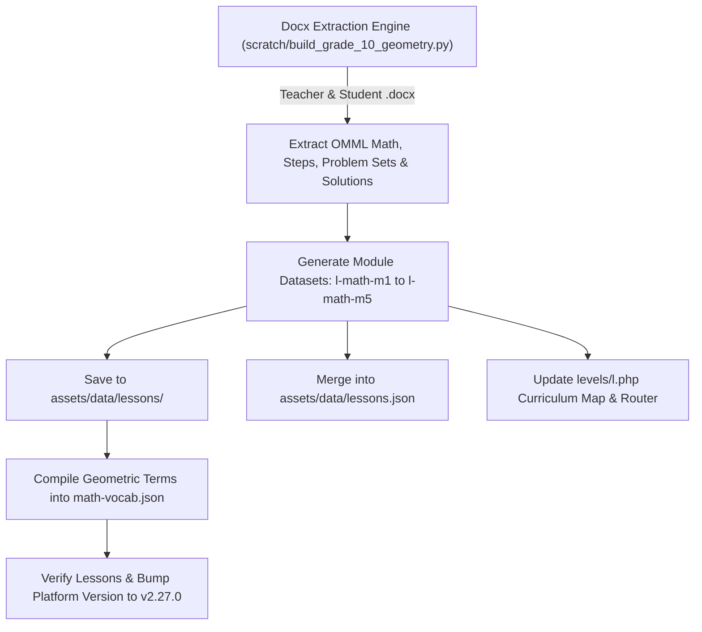

# Grade 10 Geometry Complete 117-Lesson Curriculum Buildout Plan

## 1. Executive Summary & Objective
Following the completion of Grade 9 Algebra I (105 lessons), this plan details the systematic buildout of **Grade 10 Geometry** across all 5 modules (117 lessons total) using authentic EngageNY / Eureka Math teacher and student materials located in `C:\Users\Heste\OneDrive\Documents\P-12 EngageNY - Math\Geometry`.

Each module will be compiled into a dedicated, high-performance JSON dataset in `assets/data/lessons/` (`l-math-m1.json` through `l-math-m5.json`), mirroring the interactive architecture of Grade 9 (`k-math-m1.json` to `k-math-m5.json`).

---

## 2. Curriculum Scope & Module Inventory

| Module | Title | Topic Breakdown | Lessons | Target JSON |
| :--- | :--- | :--- | :--- | :--- |
| **Module 1** | Congruence, Proof, and Constructions | Topics A–G (Basic constructions, unknown angles, rigid transformations, triangle congruence, quadrilaterals, advanced constructions, axiomatic systems) | Lessons 1–34 | `assets/data/lessons/l-math-m1.json` |
| **Module 2** | Similarity, Proof, and Trigonometry | Topics A–E (Scale drawings, dilations, similarity proofs, right triangle similarity, SOH-CAH-TOA trigonometry) | Lessons 1–34 | `assets/data/lessons/l-math-m2.json` |
| **Module 3** | Extending to Three Dimensions | Topics A–B (Area & surface area, Cavalieri's principle, volume of prisms, pyramids, cylinders, cones, and spheres) | Lessons 1–13 | `assets/data/lessons/l-math-m3.json` |
| **Module 4** | Connecting Algebra & Geometry Through Coordinates | Topics A–D (Cartesian plane proofs, parallel & perpendicular lines, distance formula, perimeters/areas of polygons, coordinate partitioning) | Lessons 1–15 | `assets/data/lessons/l-math-m4.json` |
| **Module 5** | Circles With and Without Coordinates | Topics A–E (Central & inscribed angles, arcs and sectors, secants & tangents, center-radius circle equations, cyclic quadrilaterals & Ptolemy's theorem) | Lessons 1–21 | `assets/data/lessons/l-math-m5.json` |
| **Total** | **Grade 10 Geometry** | **5 Modules / 23 Topics** | **117 Lessons** | **5 Master Datasets** |

---

## 3. Data Schema & Component Specifications
Every generated lesson in `l-math-m[1-5].json` adheres to the master lesson schema:
1. **Metadata & CCSS Standards**:
   - Unique lesson ID (e.g. `l-math-m1-a-1`), standard code (`L.M1.A.1`), CCSS benchmark (e.g. `HSG.CO.A.1`), page titles, and badge tags.
2. **Student Outcomes & Teacher Insights**:
   - Verbatim student outcomes and actionable teacher pedagogical notes.
3. **Mathematical Vocabulary**:
   - Geometric definitions (constructions, bisectors, rigid motions, dilations, secants, cyclic quadrilaterals) extracted from lesson texts.
4. **Guided Classwork & Examples**:
   - Worked teacher examples with step-by-step LaTeX geometric derivations, scaffolding tips, and common pitfall alerts.
5. **Embedded Official Problem Sets**:
   - Full student worksheet practice problems.
   - Expandable step-by-step teacher solution keys with full mathematical proof steps.
   - Clean browser printing (`printProblemSet()`).
6. **Verbatim Exit Ticket Keys**:
   - Daily assessment prompts and official Eureka Math solution keys.
7. **Check Understanding Quiz Questions**:
   - Conceptual multiple-choice questions with answer rationales.

---

## 4. Execution Workflow

---

## 5. Implementation Steps
1. **Extractor Script Development**:
   - Build `scratch/build_grade_10_geometry.py` with OMML-to-LaTeX conversion, table parsing, prompt-to-solution matching, and exit ticket extraction.
2. **Module JSON Generation**:
   - Generate `l-math-m1.json` through `l-math-m5.json` in `assets/data/lessons/`.
3. **Level L Interface Expansion**:
   - Update `levels/l.php` to display all 5 modules and 117 lessons with direct links to `l.php?l-math-m[X]-[topic]-[num]`.
4. **Master Registry & Vocabulary Synchronization**:
   - Merge all 117 lessons into `assets/data/lessons.json`.
   - Update `assets/data/math-vocab.json` with new Grade 10 geometry terms.
5. **Platform Version & Release Documentation**:
   - Bump platform version to `v2.27.0` in `src/header.php` and `src/footer.php`.
   - Create companion Help Center article `assets/text/hc-grade-10-geometry-complete.md`.
   - Write walkthrough report in `updates/docs/`.

