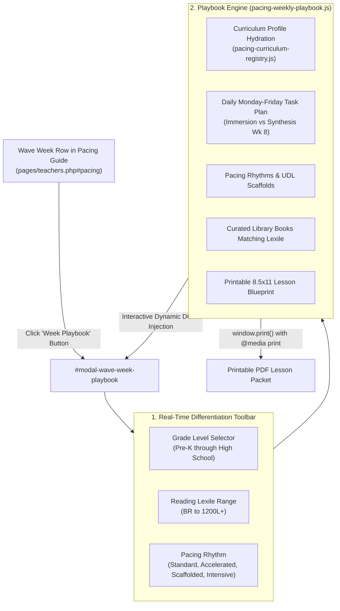

# Wave Week Playbook, Pacing Suggestions & Differentiated Library Suite Implementation Plan

## Executive Summary
This implementation plan establishes a comprehensive, interactive **Weekly Playbook & Differentiation Engine** for every week in the **Year-Round Fiscal Wave Structure (6 Waves • 48 Weeks • July 1 – June 30)** across all 11 grade levels (Pre-K through High School).

For each wave week, educators and parents can open an accessible modal dialog containing:
1. **Clear Objectives & Daily Tasks ("What Should Be Done")**: Detailed Monday through Friday instructional steps for Weeks 1–7 (Core Instructional Immersion) vs. Week 8 (Synthesis Testing, Work Completion & Planning).
2. **Pedagogical Pacing Suggestions**: Specific scheduling rhythms, time blocks, and cognitive scaffolds across four learner profiles (Standard Spiral, Accelerated Deep-Dive, Scaffolded/Low-Anxiety, and Intensive 1-on-1 Intervention).
3. **Curated Digital Library Resources**: Authentic books, literary passages, and decodable texts dynamically matched to the active grade level and reading Lexile band.
4. **On-the-Fly Differentiation Adjuster**: Real-time controls allowing users to adjust Grade Level, Reading Lexile, and Pacing Rhythm, dynamically updating the playbook.
5. **1-Click Printable Weekly Blueprint (PDF)**: Clean 8.5" x 11" printable lesson plan and student tracker sheet for homeschool reporting, accreditation binders, and student folders.

---

## Technical Architecture

---

## Step-by-Step Implementation Roadmap

### Step 1: Playbook Architecture & Engine (`assets/js/standards/pacing-weekly-playbook.js`)
- Implement `window.openWaveWeekPlaybook(fiscalWeek, gradeKey)` and `window.closeWaveWeekPlaybook()`.
- Define Lexile ranges and grade-band default mapping.
- Define library book catalog mapping aligned with Lexile bands and themes from `bookd.json`.
- Implement daily Monday–Friday breakdowns:
  - **Weeks 1–7 (Immersion)**:
    - *Monday*: Concept Launch & Concrete Modeling
    - *Tuesday*: Guided Practice & Close Reading
    - *Wednesday*: Inquiry Investigation & Hands-on Lab
    - *Thursday*: Targeted Fluency Sprint & Synthesizing Quick Write
    - *Friday*: Formative Mastery Checkpoint & Reflection
  - **Week 8 (Synthesis Week)**:
    - *Monday*: Incomplete Assignment & Portfolio Catch-Up
    - *Tuesday*: Remediation & Error Analysis Workshop
    - *Wednesday*: Formative & Summative Wave Mastery Exam
    - *Thursday*: Data Reflection & Honors Gradebook Scoring
    - *Friday*: Next Wave Curriculum Planning & Accommodation Calibration
- Implement dynamic recalibration listeners when Grade, Lexile, or Pacing Rhythm changes.
- Implement print engine: `window.printWaveWeekBlueprint()` with clean DOM preparation.

### Step 2: Modal Structure in Educator Suite (`pages/teachers.php`)
- Add `#modal-wave-week-playbook` accessible dialog with header, differentiation toolbar, tabbed/segmented content panes, print sheet wrapper, and footer actions.
- Include ``.

### Step 3: Pacing Guide Row Button Injection (`assets/js/pages/teachers-main.js`)
- In `renderPacingSchedule()`, update each wave week row in `activePacingModel === 'wave'` to include a dedicated `<button type="button" class="pacing-playbook-btn">` that invokes `window.openWaveWeekPlaybook()`.

### Step 4: Styling & Print Layout (`assets/css/pages/teachers.css`)
- Style `.playbook-modal-overlay`, `.playbook-modal-card`, `.playbook-toolbar`, `.playbook-daily-card`, `.playbook-library-card`.
- Add `@media print` styling for `body.printing-playbook` ensuring clean, professional 8.5" x 11" output.
- Add High-Contrast AAA overrides.

### Step 5: Platform Release Bump & Documentation
- Bump platform constants in `src/header.php` and `src/footer.php` to `v2.39.0`.
- Update `#footer-version-modal` in `src/footer.php`.
- Update Help Center guide `assets/text/hc-pacing-guide.md`.
- Save Walkthrough in `updates/docs/2026-11-11-wave-week-playbook-differentiation-walkthrough.md`.

